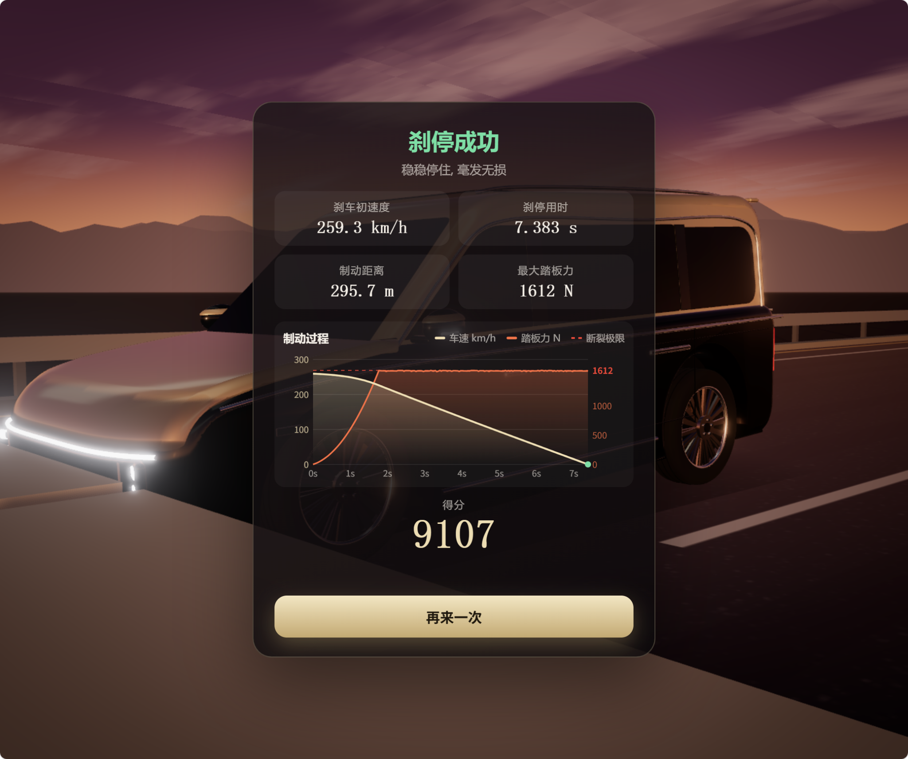

# BrakeBot

**Browser-console braking automation for [Extreme Braking Challenge](https://brake.tp0k.us/).**  
**适用于[极限刹车挑战](https://brake.tp0k.us/)的浏览器控制台自动刹车脚本。**

[简体中文](#简体中文) · [English](#english)



> **Best demonstrated successful run / 目前展示的最高成功成绩：9,107 points（分）**  
> This is an actual in-game result, not a world-record claim or proof of leaderboard submission.  
> 这是游戏内实测成功成绩，并非全球最高分声明，也不代表已提交排行榜。

| 指标 / Metric | 实测结果 / Observed result |
|:--|--:|
| 得分 / Score | **9,107** |
| 起刹速度 / Initial braking speed | 259.3 km/h |
| 刹停时间 / Stopping time | 7.383 s |
| 制动距离 / Braking distance | 295.7 m |
| 最大显示踏板力 / Max *displayed* pedal force | 1,612 N |

> **关于 1612 N / About 1,612 N:** The game rounds the displayed force to an integer. A successful run can display 1,612 N even when the internal force remains below the actual break threshold.  
> 游戏会将显示的踏板力四舍五入为整数，所以成功刹停时画面显示 1612 N，并不代表内部真实踏板力已达到断裂阈值。

---

## 简体中文

### 项目介绍

BrakeBot 是一个运行在浏览器开发者工具控制台中的自动刹车控制器，针对游戏 [极限刹车挑战](https://brake.tp0k.us/) 编写，主要按 **Microsoft Edge 约 55–60 FPS** 的运行条件调试。

脚本通过模拟空格键控制游戏中的刹车，**不直接修改成绩、不篡改游戏物理计算、也不会自动提交排行榜**。它是非官方的社区项目，与游戏作者没有隶属关系。

### 快速使用

1. 使用 **Microsoft Edge** 打开 <https://brake.tp0k.us/>。
2. 按 **F12** 打开开发者工具，切换至 **Console（控制台）**。
3. 打开本仓库中的 [`brake-bot.js`](brake-bot.js)，复制**完整代码**并粘贴到控制台，按回车执行。如果 Edge 阻止粘贴，请先阅读浏览器提示并确认代码来源可信。
4. 脚本会自动开始一局，判断起刹时机，并控制连续踩刹与短按点刹。运行过程中尽量保持游戏标签页在前台。

需要手动终止时，在控制台执行：

```javascript
brakeBot.stop();
```

查看控制器运行状态：

```javascript
brakeBot.status();
```

如果需要反复测试，建议每次运行前刷新页面，避免旧的动画帧挂钩残留。

### 工作原理

- **物理步数估计：** 根据浏览器帧时间，估计游戏以约 120 Hz 更新的物理模拟步数。
- **三帧前瞻：** 在 `hold`（持续踩）、`tap`（短按）和 `off`（松开）之间搜索，使预测的累计制动力尽可能高。
- **踏板保护：** 预测施力不超过设定上限，尝试贴近游戏 1612 N 的断裂阈值。
- **数据校验：** 对比模型预测和游戏 HUD 的踏板力读数；误差过大时自动停止控制。

主要参数位于 [`brake-bot.js`](brake-bot.js) 文件顶部：

```javascript
const STEP = 1 / 120;        // 游戏物理模拟步长（秒）
const START_DISTANCE = 297; // 距障碍物多少米开始刹车
const FORCE_CEIL = 1611.96; // 预测的踏板力安全上限（N）
const LOOK_AHEAD = 3;       // 前瞻帧数
```

**注意：** `START_DISTANCE = 297` 属于激进设置，刹车距离余量很小。如遇到帧率下降或撞击障碍物，可尝试调整为 **305 米或更大**；这仅增加安全距离，不保证得分上升。

### 限制与注意事项

- 脚本依赖游戏页面当前的 DOM ID、动画回调及物理规则；游戏更新后可能失效。
- HUD 的车速、距离和踏板力会被四舍五入；不同 FPS、硬件负载和浏览器调度会影响实际成绩。
- 9107 分是一次成功实测，不保证每次达到，也不是理论上限。
- 请自行核对游戏规则，确认是否允许使用自动化工具及是否允许将相关成绩提交排行榜。

### 项目文件

```text
BrakeBot/
├── README.md
├── brake-bot.js
├── assets/
│   └── high-score-9107.png
├── CHANGELOG.md
├── .gitignore
└── LICENSE
```

### 许可证

本项目采用 [MIT License](LICENSE) 开源许可证。

Copyright (c) 2026 Bingsong Tong

---

## English

### Overview

BrakeBot is a browser-console controller for [Extreme Braking Challenge](https://brake.tp0k.us/), primarily tuned for **Microsoft Edge at approximately 55–60 FPS**.

It simulates the spacebar to control braking. It **does not directly change scores, bypass the game's physics, or automatically submit leaderboard entries**. This is an unofficial community project and is not affiliated with the game developer.

### Quick start

1. Open <https://brake.tp0k.us/> in **Microsoft Edge**.
2. Press **F12**, then select the **Console** tab in Developer Tools.
3. Open [`brake-bot.js`](brake-bot.js), copy the **entire script**, paste it into the console, and press Enter. If Edge blocks pasting, read its warning and verify that you trust the code before proceeding.
4. The script starts a new run, selects the braking point, and controls the brake automatically. Keep the game tab in the foreground for more consistent timing.

To stop the controller:

```javascript
brakeBot.stop();
```

To inspect its current status:

```javascript
brakeBot.status();
```

Refresh the page before repeated attempts if an earlier animation hook may still be active.

### How it works

- **Physics-step estimation:** estimates the number of approximately 120 Hz simulation steps executed during a browser animation frame.
- **Three-frame lookahead:** searches `hold`, `tap`, and `off` actions to maximize predicted cumulative braking force.
- **Pedal protection:** predicts the braking force and tries to stay below the game's 1,612 N pedal-break threshold.
- **HUD validation:** compares estimated pedal force against the on-screen value and stops controlling if they diverge significantly.

Key parameters near the top of [`brake-bot.js`](brake-bot.js):

```javascript
const STEP = 1 / 120;        // Physics step in seconds
const START_DISTANCE = 297; // Start braking at this distance (m)
const FORCE_CEIL = 1611.96; // Predicted pedal-force ceiling (N)
const LOOK_AHEAD = 3;       // Number of frames to look ahead
```

**Warning:** `START_DISTANCE = 297` is an aggressive setting with very little stopping margin. If you experience low FPS or barrier collisions, try **305 m or more**. Starting earlier creates more stopping room; it does not directly raise your score.

### Limitations and fair use

- The controller depends on the current page's DOM IDs, animation callback, and game rules; site updates may break it.
- The HUD rounds speed, distance, and force values. FPS, hardware load, and browser scheduling can all change the result.
- The 9,107-point screenshot documents one successful run, not a guaranteed score or theoretical maximum.
- Review the game's rules before using automation or submitting automatically assisted results to its leaderboard.

### Repository contents

```text
BrakeBot/
├── README.md
├── brake-bot.js
├── assets/
│   └── high-score-9107.png
├── CHANGELOG.md
├── .gitignore
└── LICENSE
```

### License

This project is licensed under the [MIT License](LICENSE).

Copyright (c) 2026 Bingsong Tong
